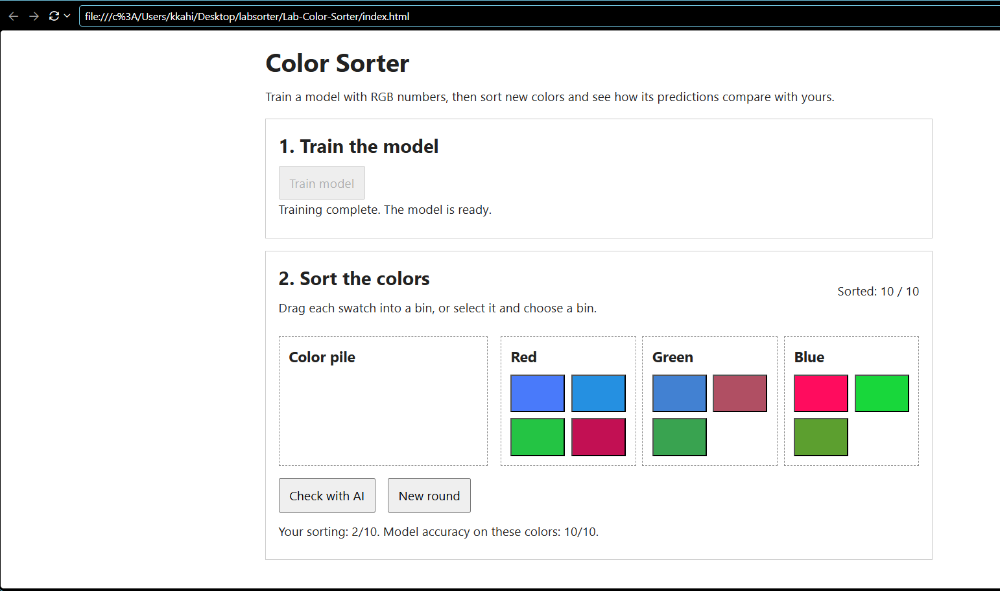
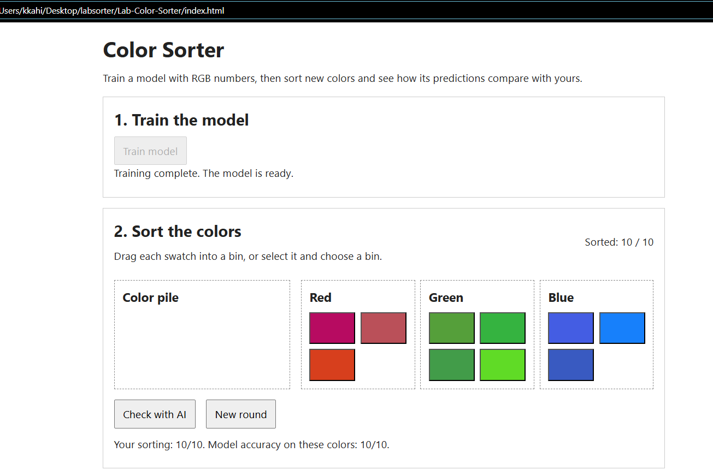

# TenserFlow.js
## Project instructions

> Learning Objective: Using LLM assisted coding build a Machine Learning game.

Using [ml5.js](https://ml5js.org/) and the pre-existing code base, complete the project so that the user can drag sprites into bins and the AI will check if all items are in the correct bin and give a score.


## TODO

Complete the `trainModel()` and `classify()` methods in the `js/ML.js` file. Work through one step at a time and test after each change. The rest of the game is already implemented and should work once the ML code is complete.

## Example Prompts

Below are some example prompts you can use.
Feel free to modify them or write your own. Remember what ever AI tool you use, feed it the entire code base so it has context for your prompts.

```
Read the starter files and explain what `trainModel()` and `classify(color)` need to do for the game to use a trained model. Do not change any files.
```

```
In `js/ML.js`, create a helper that returns labeled RGB training examples for red, green, and blue. Return an array of objects with `red`, `green`, `blue`, and `label` properties. Make 40 examples for each color. Only change `js/ML.js`.
```

```
Implement `trainModel(updateProgress)` in `js/ML.js`. It should use the training examples to train a classifier that predicts a color label from RGB values. Save the trained model on the instance. Call `updateProgress` with status messages and finish only after training is complete. If training fails, let the error reach the caller. Use the ml5 documentation linked below. Only change `js/ML.js`.
```

```
Implement `classify(color)` in `js/ML.js`. Given an object with `red`, `green`, and `blue` values, use the trained model to return the predicted color label as a lowercase string. Report a clear error if the model has not been trained. Only change `js/ML.js`.
```

```
Review `js/ML.js` and check that `trainModel(updateProgress)` and `classify(color)` meet the requirements above and work with the existing game. Fix only problems in `js/ML.js`, then tell me how to test the game.
```

### Helpful docs

Feel free to read these with your human eyes or feed them to your AI so it hallucinates less.

- [ml5.js neuralNetwork reference](https://docs.ml5js.org/#/reference/neural-network) — creating a classifier, adding data, normalizing, training, and classifying.
- [JavaScript async functions](https://developer.mozilla.org/en-US/docs/Web/JavaScript/Reference/Statements/async_function) — using `async` and `await`.
- [JavaScript Array.from()](https://developer.mozilla.org/en-US/docs/Web/JavaScript/Reference/Global_Objects/Array/from) — making a set number of training examples.

## What to Submit

- URL to **your** git repository with the completed game code.
- Either edit this `README.md` file or create a separate file that documents the following:
    - Each prompt you used to build the game.
    - A short one sentence description of what the prompt was for. And where the project was before and after the prompt.
        - **This documentation needs to be detailed**.

# Project documentation with prompts

# Color Sorter Lab 

## Project Goal
Complete the machine-learning portion of the Color Sorter game by implementing `trainModel(updateProgress)` and `classify(color)` in `js/ML.js`.

## Prompt 1
**Prompt used:**  
Read the starter files and explain what `trainModel()` and `classify(color)` need to do for the game to use a trained model. Do not change any files.

**Purpose:**  
Understand how `ML.js` connects to the existing game before changing code.

**Before:**  
`trainModel()` and `classify()` were empty methods.

**After:**  
Identified the two empty methods and the parts i am required to complete.
File remains **unchanged**.
The required flow was identified: generate labeled RGB examples, create an ml5 neural-network classifier, add and normalize data, train the model, save the trained model on the class instance, then use it to classify new RGB colors.

## Prompt 2
**Prompt used:**  
In `js/ML.js`, create a helper that returns labeled RGB training examples for red, green, and blue. Return an array of objects with `red`, `green`, `blue`, and `label` properties. Make 40 examples for each color. Only change `js/ML.js`.

**Purpose:**  
Create the supervised training dataset required by the classifier, the 120 training examples.

**Before:**  
The file imported `COLORS` and `createColorExample`, but did not use them.

**After:**  
A helper creates 40 randomized labeled examples for each of the three colors, for 120 examples total.
The trainModel is complete but the classify(color) still needs to be worked on.

## Prompt 3
**Prompt used:**  
Implement `trainModel(updateProgress)` in `js/ML.js`. It should use the training examples to train a classifier that predicts a color label from RGB values.
Save the trained model on the instance. Call `updateProgress` with status messages and finish only after training is complete. If training fails, let the error reach the caller. Use the ml5 documentation. Only change `js/ML.js`.

**Purpose:**  
Train the ml5 neural network and integrate training progress with the existing UI.

**Before:**  
Clicking Train Model could not create or train a classifier.

**During**

I ran into an issue here, "Forbidden. File does not reside within a trusted folder" i was editing the file in the zip file, and so it couldnt run, i also had not trusted the folder in VS. I put the folder on the desktop after extracting it and trusted the folder in VS. 
I could then opend index.html on the intergrated browser but i couldnt "train the data" listed error was 'Training failed: The highest priority backend 'webgpu' has not yet been initialized. Make sure to await tf.ready() or await tf.setBackend() before calling other methods', i had to do some light reading on how tensorflow is initiated and what webgpu was, chat suggested i add 'await tf.ready();' on top of the trainModel() which brought about another error 'Training failed: tf is not defined', after reading through what chat suggested to do this step had to be scrapped out because it needed other files to be edited, only the 'js/ML.js' file needed to be edited.
Finally figured out that i had to use ml5's own backend setter, because as per the ml5 project documentation 'ml5.setBackend("webgl") or "cpu" may be required for neuralNetwork()', ml5 provides an appropriate backend API no need to use Tensorflow for that.

**After:**  
The backend is explicitly initialized through ml5.setBackend('webgl') before the neural network is created, prompt returns "Training complete. The model is ready."
The method creates an ml5 classification network, adds the 120 examples, normalizes them, trains for 40 epochs with a batch size of 12, waits for training to finish, and reports progress to the page.

## Prompt 4
**Prompt used:**  
Implement `classify(color)` in `js/ML.js`. Given an object with `red`, `green`, and `blue` values, use the trained model to return the predicted color label as a lowercase string. Report a clear error if the model has not been trained.
Only change `js/ML.js`.

**Purpose:**  
Allow the game to compare the player's sorting against the trained AI.

**Before:**  
The game could not get a prediction from the model. The model could train successfully, but classify(color) was empty, so the game could not ask the AI to identify new colors.

**After:**  
The method 'classify(color)' checks that the model exists, classifies the RGB values and sends them to the trained network, validates the result, and returns the predicted label in lowercase.

## Prompt 5
**Prompt used:**  
Review `js/ML.js` and check that `trainModel(updateProgress)` and `classify(color)` meet the assignment requirements and work with the existing game. Fix only problems in `js/ML.js`, then explain how to test the game.

**Purpose:**  
Perform a final integration review before submitting.

**Before:**  
The implementation had not been checked against the game flow.

**After:**  
The completed methods match the existing `script.js` and `ColorGame.js` APIs training enables the Check with AI button, and checking results classifies all ten swatches and compares model predictions with their true labels.
The final review confirmed that the model uses the required RGB inputs, labeled training examples, normalization, async training, progress updates, backend initialization, and lowercase classification output.
The game was tested by training the model, sorting all swatches, and using Check with AI to compare the player’s sorting against the model’s predictions.


